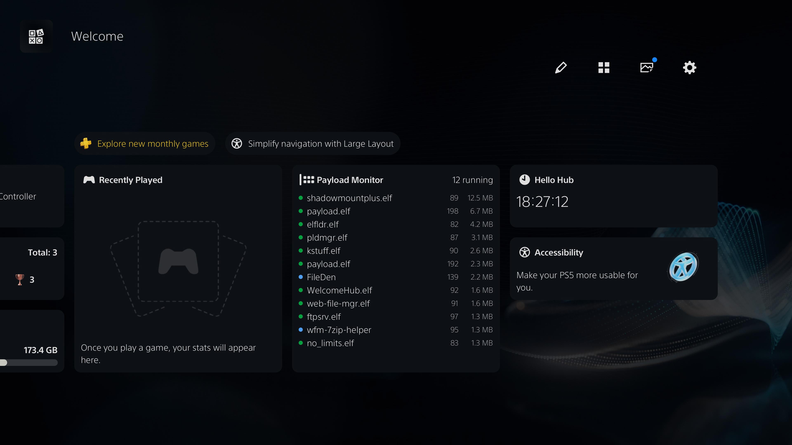
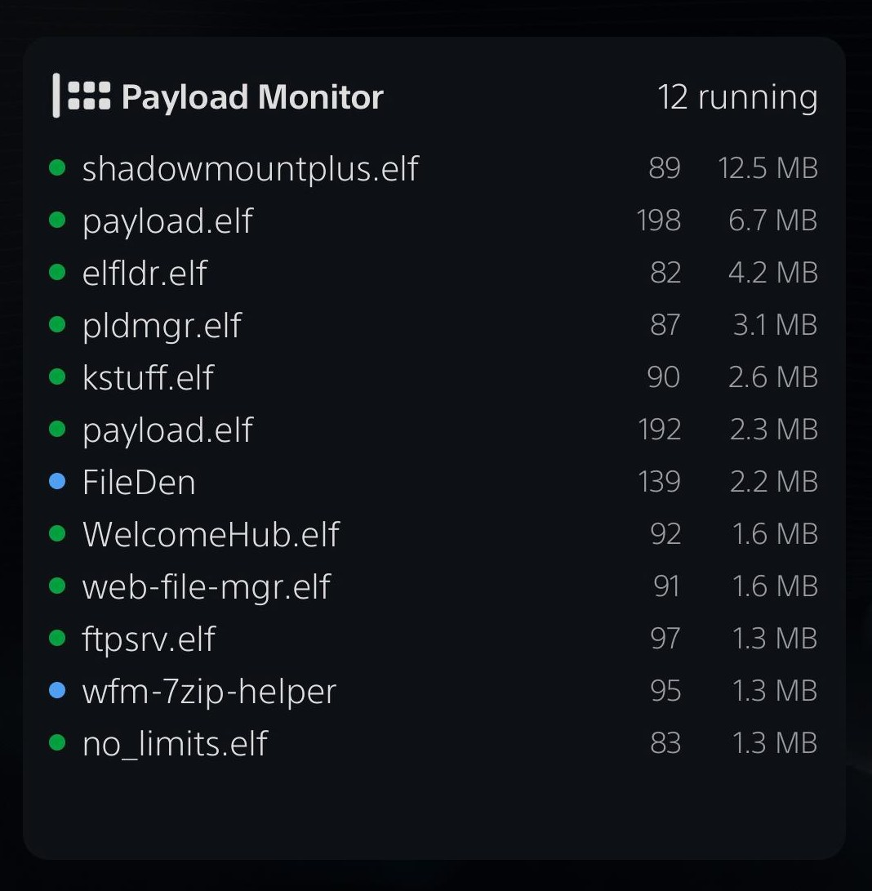

# ps5-wh-widgets

## WelcomeHubActivator

This project is meant to be used together with
**[WelcomeHubActivator](https://github.com/ghost1372/WelcomeHubActivator)** by
**[ghost1372](https://github.com/ghost1372)**. That project is an ELF payload that turns on the PS5 Welcome Hub (FW 10.00–13.60), and the change survives restarts. This project adds support for custom widgets in the hub once it is active, so run WelcomeHubActivator first if the Welcome Hub isn't already on.

Everything this project does is applied **in memory**, at runtime: it hooks the running Welcome Hub process and injects the widgets live. **No system files are modified** — nothing on the console's storage is patched or replaced. A reboot undoes all of it, returning the console to a completely stock state; just run the payload again to bring the widgets back.

Credit and thanks to ghost1372 for WelcomeHubActivator (MIT licensed), and to the
projects it credits.



## Welcome Hub

The Welcome Hub is a customizable panel on the PS5 home screen, added in a 2024 system software update. It shows a grid of widgets — battery, trophies, storage, friends, recently played and more — that the user can rearrange, resize and toggle from an "Edit Widgets" screen. Sony ships a fixed set of widgets; this project lets you add your own alongside them.

## Widgets

The Welcome Hub is built with **React Native**, so a widget is just a **React view** — a component built from native primitives like `View`, `Text` and `Image`, not HTML/CSS. There is no DOM, no `div`, no `window`.

The SDK hands your widget everything it needs through a single handle, `globalThis.__wh`: React and the RN primitives, the hub's own stock-styled `Title`/`Label` components, icon and font helpers, and your parsed `config.json`. The framework wraps each widget in an error boundary (a bad render only breaks that one tile), gives it native focus and resizing, and shows it in the Edit Widgets list with your title, icon and description.

For the full API, sizes, styling rules and the stock-look components, see **[docs/WIDGET_SDK.md](/docs/WIDGET_SDK.md)**.

## Included Widgets

I've created two widgets that are included in this project. You can grab them from the [Releases](/releases).

### Hello Hub

A minimal reference widget: a live, ticking clock. It exists to demonstrate the SDK end to end — the stock title row, stock text, an icon, hooks and a timer — and is the easiest starting point for writing your own.


#### Payload Monitor

Shows the homebrew payloads currently running on the console, each with its PID and memory use, updating live. It pulls the data from the [ps5-payload-manager](https://github.com/ps5-payload-dev)'s local server and filters out Sony's own system processes, so you see just what you've launched.



## Building a Widget

A widget is a folder with a `widget.js` (the component) and a `config.json` (its metadata). No build step, no bundler — `widget.js` is plain JavaScript evaluated once when the hub loads, and must be self-contained (no `import` / `require`).

**`widget.js`** — grab React + the primitives from the `wh` handle, build a component with `React.createElement` (no JSX), and register it:

```js
// widget.js
(function (wh) {
  var React = wh.React;
  var View = wh.View;
  var Text = wh.Text;

  function MyWidget(props) {
    return React.createElement(
      View,
      {
        style: {
          flex: 1,
          width: 504,
          padding: 16,
          borderRadius: 16,
          backgroundColor: '#1b1d23',
        },
      },
      React.createElement(
        Text,
        { style: { color: '#ffffff', fontSize: 24 } },
        'Hello Hub'
      )
    );
  }

  wh.register(MyWidget);
})(globalThis.__wh);
```

**`config.json`** — the widget's id, its name/icon/description in the Edit Widgets list, and its starting size:

```jsonc
{
  "id": "payload-monitor",      // required, unique, not a stock id
  "title": "Payload Monitor",   // Edit Widgets list name (default: id)
  "description": "...",         // Edit Widgets description shown on focus (optional)
  "glyph": "glyph.png",         // white-on-transparent PNG in this folder -> icon "wh:<id>"
  "iconId": "trophies",         // OR a stock IconPS glyph (default: "wh:<id>" if glyph, else app_welcome)
  "iconFallback": "grid",       // stock glyph used if the image glyph can't load
  "size": 1                     // starting WidgetSize (DEFAULT=1, LARGE=2, FULL=3)
}
```

**File structure** — drop your widget folder into `/data/wh-widgets/` on the console. Each immediate subfolder is one widget, named by its id:

```
/data/wh-widgets/
  payload-monitor/
    widget.js        # required – the component module
    config.json      # required – id, title, size
    icon.png         # optional – Edit Widgets list icon
    README.md        # optional – ignored by the loader
```

Full authoring guide, including styling, sizes, icons and the stock-look components: **[docs/WIDGET_SDK.md](/docs/WIDGET_SDK.md)**.
