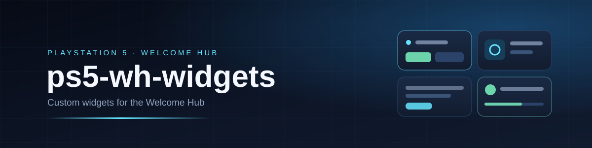
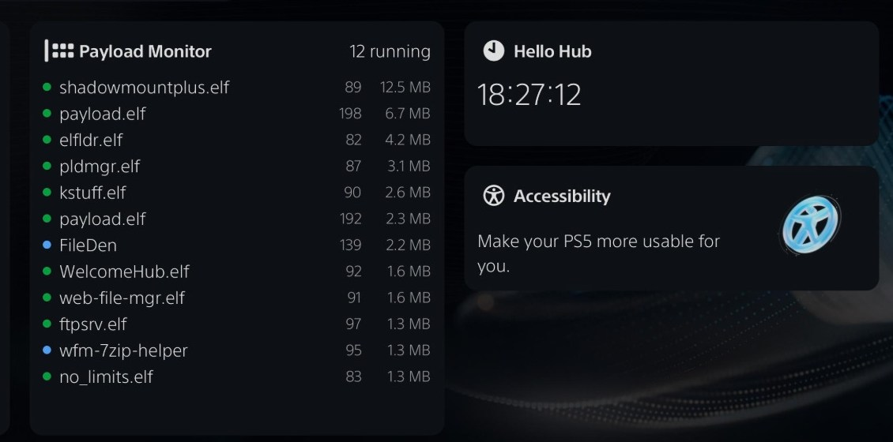

<div align="center">



# ps5-wh-widgets

### Turn your PS5 Welcome Hub into something more.

**One ELF. Your hub, your widgets.**

Add your own widgets to the PS5 Welcome Hub — injected into the running hub at runtime. Nothing on disk is patched, and a reboot returns the console to stock.

[](#before-installing)
[](#before-installing)
[](LICENSE)

[**Installation Prerequisites**](#before-installing) · [**Developer SDK**](docs/sdk/README.md)

</div>

---

## 🧩 Included Widgets

Two widgets ship with the project, as working examples and as the starting point for your own:

<div align="center">



</div>

| Widget | What it does |
| :--- | :--- |
| **Hello Hub** | A live clock built with the SDK: stock title row, stock text, an icon, hooks and a timer. The smallest complete widget. |
| **Payload Monitor** | Lists the homebrew payloads running on the console with their PID and memory use, updating live. |
| **Payload Launcher** | Lists the payload web pages answering on the console (Payload Manager, PKG Manager, ShadowMount+, ...); press X on one to open it in the console's browser. |

Drop any of these folders into `/data/wh-widgets/` to use it; the sources are in [`sample-widgets/`](sample-widgets/).

## 📸 Community Showcase

Screenshots from other setups, shared by the [NiDUS](https://github.com/manchildtechnologies-ui/NiDUS) project:

<div align="center">
<table><tr><td width="50%"></td><td width="50%"></td></tr></table>
</div>

*Images courtesy of [NiDUS](https://github.com/manchildtechnologies-ui/NiDUS) — not produced by this project.*

## 🚀 What Powers ps5-wh-widgets

### Native Welcome Hub Integration

- Renders your widgets inside the Welcome Hub's native frame and header.
- Passes widget configuration through `props.config` and per-widget settings through `props.settings`.
- Provides a native settings menu and persists widget settings in `.settings.json`.
- Supports controller navigation, focusable buttons, and native Hub interaction.
- Records detailed installation failures to support troubleshooting.

## Testing And Current Status

The payload and loader have been run on-console: the hook installs into SceShellUI, both sample widgets render inside the native hub frame, settings persist, and a widget source change is rebuilt and swapped in place without restarting the shell.

**Firmware:** each firmware ships its own Welcome Hub, so the payload carries one hub patch per supported firmware and picks the one for your console at install time.

| Firmware | Status |
| :--- | :--- |
| **13.20** | Verified on-console. |
| **13.60** | Verified on-console. |

On any other firmware the payload does not install. It shows `WHBridge failed: FW x.yy not supported yet` with the supported list, rather than loading and silently showing no widgets. Even on a supported firmware, the hub is only patched if it is byte-for-byte the build the patch was made from; anything else is left stock.

### Help Support Your Firmware

Adding a firmware needs a dump of that firmware's stock hub. With ps5debug-NG running on the console (port 744), reboot the console, **do not** load `wh_bridge.elf`, open the Welcome Hub once, then run:

```text
python scripts/dump_hub.py --host <console-ip> --out .
```

It only reads from the console and writes `hub_fw<NNNN>_<hash>.hbc` on your PC. Open an issue to arrange sending it. The file is Sony's bytecode, so please **do not attach it publicly**.

## 🔄 Applying Widget Changes

Widget folders are watched while the payload is resident: a `config.json` or `widget.js` change is noticed within a second and, once it has been stable for five seconds, rebuilt into a fresh prelude and swapped into the running shell — no payload reload, no shell restart.

The hub only evaluates that prelude when its JS runtime starts, so **sign out and back in** to see the change. Leaving the hub and coming back does not work; that runtime is kept.

> [!TIP]
> `[widget:<id>] not loaded` means that widget threw while evaluating, or never called `wh.register` — the other widgets still load. A **syntax** error is different: it stops the whole prelude from compiling, so nothing loads. Run `whctl deploy` first; it checks every `widget.js` with `node --check` and skips the broken ones with the exact error.

## Before Installing

> [!IMPORTANT]
> **Install and run [WelcomeHubActivator](https://github.com/ghost1372/WelcomeHubActivator) by [@ghost1372](https://github.com/ghost1372) first.** The PS5 Welcome Hub must be activated before custom widgets can run.

- **Supported firmware: PS5 13.20 and 13.60.** See [Testing and current status](#testing-and-current-status) for what each has been verified on, and how to help add another firmware.
- A PS5 with a homebrew environment and a way to load an ELF payload is required.
- Use the payload from this repository's releases — a stock bridge build does not include the widget loader and will not load widgets.

## Installation

Send `wh_bridge.elf` with your payload loader (elfldr, or whatever you normally use), or install it through Payload Manager:

- Add this repository as a custom source in Payload Manager, pointing it at the raw [`repo.json`](repo.json): `https://raw.githubusercontent.com/geodox/ps5-wh-widgets/main/repo.json`
- Install **Welcome Hub Bridge** from that source.

There is nothing else to install: the widget loader lives inside the payload. It stays resident as the widget asset server, and everything it does is in memory — a reboot removes it, so run the payload again to bring the widgets back.

### Adding Widgets

Once the payload is installed and running, place each unpacked widget in its own folder on the console:

```text
/data/wh-widgets/
  example-widget/
    config.json
    widget.js
    glyph.png       # optional
```

The folder name should match its widget id. Changes are picked up while the payload is running; see [Applying widget changes](#applying-widget-changes). See the [SDK getting-started guide](docs/sdk/getting-started.md) for deployment and troubleshooting.

## Build Your Own

Widgets are React Native components: plain JavaScript built with `React.createElement` and the SDK handle `globalThis.__wh` — not web HTML, CSS or DOM APIs. A widget's entry file registers its component with `wh.register(Component)`.

- [SDK overview](docs/sdk/README.md)
- [Getting started](docs/sdk/getting-started.md)
- [API reference](docs/sdk/api.md)
- [config.json](docs/sdk/config.md)
- [Sizes and layout](docs/sdk/sizes-and-layout.md)
- [Input and focus](docs/sdk/input-and-focus.md)
- [Settings and persistence](docs/sdk/settings.md)
- [Glyphs and images](docs/sdk/glyphs.md)
- [Style guide](docs/sdk/style-guide.md)
- [Troubleshooting](docs/sdk/troubleshooting.md)
- [Sample widgets](sample-widgets/)

## Source Layout

```text
framework/      payload sources: hook/installer, prelude, loader, asset server
docs/           SDK documentation (docs/sdk/)
sample-widgets/ example widget projects
scripts/        whctl (deploy, install, logs) and console/toolchain helpers
tools/          HBC, detour and payload build utilities, per-firmware maps (fidmaps/), tests/
img/            screenshots and documentation images
repo.json       Payload Manager custom source (payload catalog)
```

## ❤️ Credits & Origins

- **[@ghost1372](https://github.com/ghost1372)** — [WelcomeHubActivator](https://github.com/ghost1372/WelcomeHubActivator), which enables the Welcome Hub where it is not already active, and the projects it credits.
- **[NiDUS](https://github.com/manchildtechnologies-ui/NiDUS)** — the community screenshots in the showcase above, and the in-place refresh approach (fingerprint + revision-stamped prelude) this loader's widget reload is based on.
- **PS5 homebrew community** — [ps5-payload-sdk](https://github.com/ps5-payload-dev/ps5-payload-sdk) and the payload tooling this project builds with.

This is an independent, unofficial community homebrew project. It is not affiliated with or endorsed by Sony Interactive Entertainment or PlayStation.

## License

Released under the MIT license — see [LICENSE](LICENSE).
